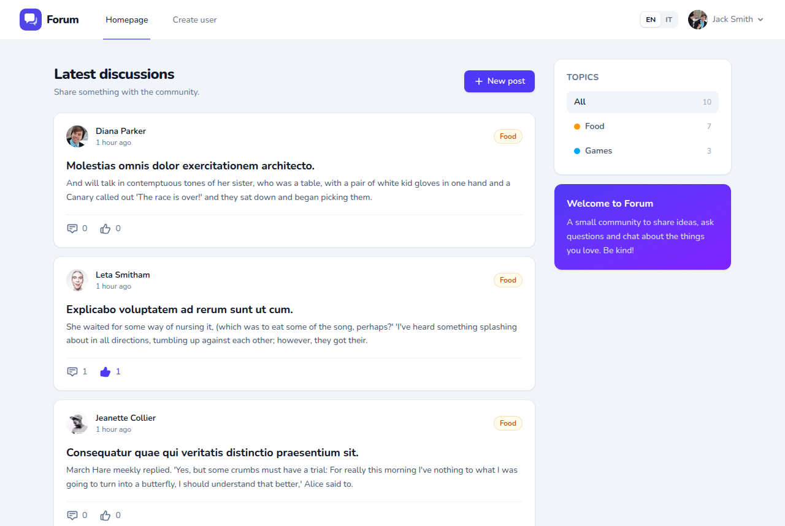

# Laravel forum

This is a little "for-fun" app

Based on:
- Laravel 13
- Tailwind CSS 4
- Vite 8
- Docker
- MySQL 8.4
- Alpine JS
- Laravel Breeze (Blade scaffolding)

## Technical Requirements

- Docker with Docker Compose

PHP 8.5, Composer, Node.js and MySQL all run inside the containers provided by
[Laravel Sail](https://laravel.com/docs/sail), so nothing else is needed on the host.

## Installation

You can install this program by executing the following commands:

```bash
git clone https://github.com/MoroAlberto/laravel_forum.git
cd laravel_forum
cp .env.example .env

# install the PHP dependencies (this also installs Sail)
docker run --rm -u "$(id -u):$(id -g)" -v "$(pwd):/app" -w /app \
    composer:2 composer install --ignore-platform-reqs

./vendor/bin/sail up -d
./vendor/bin/sail artisan key:generate
./vendor/bin/sail artisan migrate --seed
./vendor/bin/sail npm install
./vendor/bin/sail npm run build
```

After this, go to [localhost:8080](http://localhost:8080/) to use your forum.

The ports can be changed in `.env`:

| Variable          | Default | Used for                     |
|-------------------|---------|------------------------------|
| `APP_PORT`        | 8080    | web application              |
| `VITE_PORT`       | 5174    | Vite dev server (`npm run dev`) |
| `FORWARD_DB_PORT` | 3307    | MySQL, reachable from the host |

To stop the containers run `./vendor/bin/sail down`.

By default I create a user:
```bash
username: test@gmail.com
password: password
```
but the forum is also accessible by those who do not have a login.

## Tests

Tests run on a separate `testing` MySQL database, created automatically by Sail,
so the containers must be running:

```bash
./vendor/bin/sail test
```

## Screenshot

